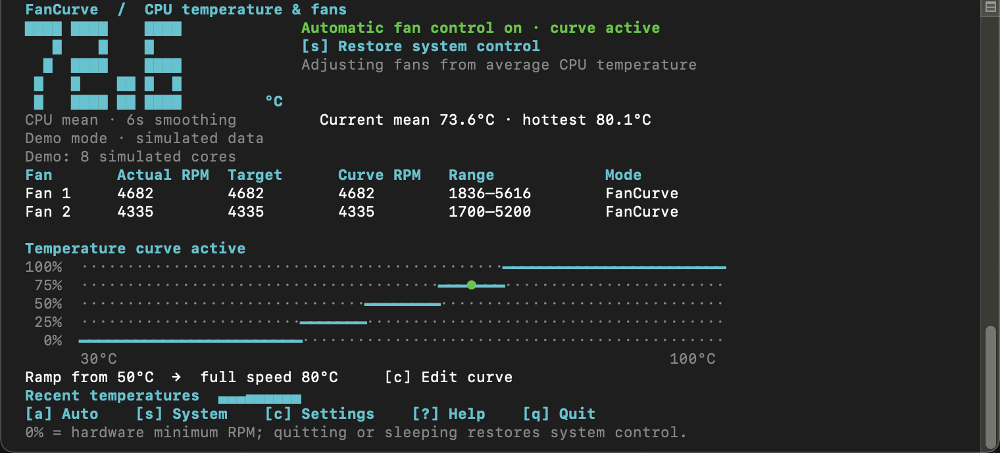

# FanCurve

English · [简体中文](README.zh-CN.md)

**FanCurve is a single-file Terminal fan controller for Intel Macs.** It maps the average CPU core temperature to each fan's own RPM range, shows live readings and the temperature curve in a TUI, and displays the current temperature in the macOS menu bar. It uses the Python standard library and needs no build step. **Apple Silicon is not supported.**



*Captured from `--demo --lang en` with simulated sensors and fans; no real fan was changed.* [Chinese screenshot](docs/screenshots/fancurve-zh.png)

## Try it safely

On an Intel Mac with Python 3.9 or newer, clone the repository and start the hardware-free demo:

```sh
git clone https://github.com/danshuitaihejie/FanCurve.git
cd FanCurve
uv run --no-project fan_curve.py --demo --lang en
```

Use `--monitor` for read-only measurements from the real Mac. A normal launch requests administrator authorization after the first valid reading and then starts automatic fan control:

```sh
uv run --no-project fan_curve.py --monitor --lang en
uv run --no-project fan_curve.py --lang en
```

If `git` is unavailable, download this repository as a ZIP from GitHub. You can also run `python3 fan_curve.py --demo --lang en`; there are no third-party Python dependencies. Double-click **Launch in English.command** for the English UI or **启动.command** for Chinese. Both launchers use `uv` when available and fall back to `python3`. The `--lang en` and `--lang zh` options select the language; Chinese remains the default when no option is given. Both languages share the same fan-control logic and saved curve.

## How fan control works

| Behavior | Default |
| --- | --- |
| Input | Arithmetic mean of valid CPU core sensors, followed by a rolling average; CPU package temperature is used if core sensors are unavailable. |
| Curve | Start increasing at **50°C** and reach each fan's reported maximum RPM at **80°C**. |
| Smoothing and refresh | 6-second smoothing window; readings and controls refresh every 2 seconds. |
| Hotspot protection | A known CPU/GPU hotspot at **90°C or above** takes priority and requests full speed; the protection clears below **85°C**. |
| Readback | After an SMC write, FanCurve checks the reported mode and target RPM. If the write cannot be confirmed, it stops automatic control and requests system control. |

The large number is the **smoothed average CPU temperature** used by the curve. The fan table distinguishes actual RPM, the current hardware target, and the curve's expected target. The graph is marked as a preview when FanCurve does not control the fans. The interface needs at least **78 columns × 24 rows**.

| Key | Action |
| --- | --- |
| `a` | Enable or retry automatic control. In a demo, this affects only simulated fans. |
| `s` | Request restoration of system fan control. |
| `c` | Edit start temperature, full-speed temperature, and smoothing time. Use arrow keys; Enter saves and Esc cancels. |
| `?` | Show help. |
| `q` | Quit and request restoration of system fan control. |

Do not let another fan-control app control the same fans at the same time. If Macs Fan Control is installed, restore its automatic mode and quit it before enabling FanCurve.

## Optional unattended login startup

`--install` sets up a protected helper and a per-user login item. It needs one administrator authorization. The Mac must provide `/usr/bin/python3` 3.9 or newer; if macOS prompts to install Command Line Tools, finish that installation first. The system sudoers file must include `/private/etc/sudoers.d`.

Keep `fan_curve.py` in its final location, then run:

```sh
uv run --no-project fan_curve.py --install --lang en
```

The installer places a root-owned copy of the script and a fixed launcher under `/Library/PrivilegedHelperTools`. It validates a narrow `/private/etc/sudoers.d/fancurve` rule with `visudo`; that rule lets only the installing user start the fixed helper **without arguments** and without another password prompt. It also writes a launcher under `~/Library/Application Support/FanCurve/` and a LaunchAgent under `~/Library/LaunchAgents/`. Missing protected directories are created only after their parent permissions are checked. No administrator password is stored, and installation itself does not start fan control.

On later logins, FanCurve starts after the user logs in, enables control after a valid reading, minimizes its own Terminal window, and keeps the temperature in the menu bar. **Click the temperature to reopen that same window; minimizing it leaves fan control running.** Closing the window or pressing `q` exits. The language selected during `--install` persists for login startup. This is a login item, not a pre-login system service.

If you move the script, change the startup language, or update helper logic, run `--install` again from the new script. For UI-only updates, replace the script and restart FanCurve. To remove the helper, sudoers rule, launcher, and login item, run:

```sh
uv run --no-project fan_curve.py --uninstall --lang en
```

Uninstall requires administrator authorization and leaves the original script and `.fancurve.json` configuration intact.

## Failure behavior and diagnostics

FanCurve requests system control when it exits, sleeps, loses valid readings, or loses contact with the helper for 12 seconds. The protected helper retries restoration when needed. A forced `SIGKILL` or hardware failure can prevent confirmation, so restoration cannot be guaranteed in every failure mode. After waking, an installed protected session tries once to resume control; press `a` if that attempt fails.

```sh
uv run --no-project fan_curve.py --probe --lang en     # Read-only hardware JSON
uv run --no-project fan_curve.py --simulate --lang en  # Print a simulated curve
```

Settings live beside the script in `.fancurve.json`. FanCurve implements the SMC interface independently with Python `ctypes`, with [SMCKit](https://github.com/beltex/SMCKit) as an ABI reference. It only supports Intel Macs running macOS.

Run the tests with:

```sh
UV_CACHE_DIR=.work/uv-cache uv run --no-project python3 -m unittest discover -s tests -v
```

Tests cover curve logic, simulated hardware, UI layout, both languages, and protected-install file handling in temporary directories. The demo and read-only tests do not prove that a particular Mac accepts fan-speed writes.

[MIT License](LICENSE)
