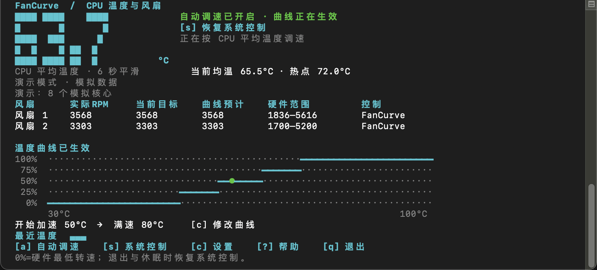

# FanCurve

[English](README.md) · 简体中文

FanCurve 是面向 **Intel Mac** 的终端风扇控制工具。它按 CPU 核心平均温度调速，在终端显示实时温度、风扇转速与曲线，并在 macOS 菜单栏显示温度。源代码是单文件 Python 脚本，不依赖第三方 Python 包。**不支持 Apple Silicon。**



*截图来自 `--demo --lang zh`，使用模拟数据，没有操作真实风扇。*[English screenshot](docs/screenshots/fancurve-en.png)

普通启动会在读到有效温度后尝试开启调速并请求管理员授权。运行 `--install` 可一次授权安装受保护 helper 和登录项；此后每次登录会在后台自动开启调速，终端窗口先最小化，菜单栏持续显示温度，无需再次输入密码。

## 启动

推荐使用 `uv`。先运行不会访问真实硬件的演示界面：

```sh
git clone https://github.com/danshuitaihejie/FanCurve.git
cd FanCurve
uv run --no-project fan_curve.py --demo --lang zh
```

如果没有 `git`，也可从 GitHub 下载仓库 ZIP。确认适用后，`uv run --no-project fan_curve.py --monitor --lang zh` 只读监测；`uv run --no-project fan_curve.py --lang zh` 会在读到有效温度后请求授权并尝试调速。也可以双击 `Launch.command`（默认中文）或 `Launch-English.command`（英文）；启动器会优先使用 PATH 中的 `uv`，其次尝试 `$HOME/.local/bin/uv`，最后使用 `python3`。

两种语言共用同一份控制逻辑和风扇曲线。`--lang` 支持 `auto`、`zh` 和 `en`；直接运行 CLI 时默认中文，app 默认根据系统语言或已保存偏好选择。安装登录项时所选语言也会用于以后每次登录。

只监测模式仍可按 `a` 手动启用调速。`--demo` 使用模拟数据，并默认自动启用模拟调速，不会操作真实风扇。
手动运行时窗口默认可见；如果也想先隐藏它，可加 `--start-hidden`。

### macOS app

在 macOS 上构建时，用 uv 安装可移植的 Intel 版 Python，再构建应用和 ZIP。

```sh
uv python install cpython-3.12-macos-x86_64-none
UV_CACHE_DIR=.work/uv-cache uv run --no-project build_app.py
```

命令会生成 `dist/FanCurve.app` 和 `dist/FanCurve-macOS.zip`。应用自带可移植 Python，会打开终端界面和菜单栏温度显示。使用打包版无需另装 Python、uv 或命令行工具。可将 `FanCurve.app` 拖入 Applications。首次启动时会创建 `~/Library/Application Support/FanCurve/FanCurve.terminal`，并导入专属的 FanCurve Terminal 描述文件。该描述文件使用 100×32 窗口、关闭时不询问，并在程序正常退出后自动关闭窗口；只会使用 FanCurve 专属描述文件。app 默认根据系统语言或已保存偏好选择中英文，在界面按 `l` 可切换并保存偏好。

app 设置保存在 `~/Library/Application Support/FanCurve/settings.json`；直接运行 TUI 命令时仍使用脚本旁的 `.fancurve.json`。从源码目录运行 `uv run --no-project fan_curve.py --launch-app --lang en` 也会通过专属描述文件启动 app；直接运行 TUI 的命令仍可使用。生成包为本地 ad hoc 签名，未使用 Developer ID 签名或公证，也不通过 App Store 分发。

## 登录时启动

登录自启需要一次管理员授权，系统 sudoers 须启用 `/private/etc/sudoers.d`。打包版会把自带 Python 复制到 root 持有的 helper 目录。将应用放到「应用程序」后，可运行下面的命令。卸载时把 `--install` 换成 `--uninstall`。

```sh
"/Applications/FanCurve.app/Contents/Resources/python/bin/python3" -IB \
  "/Applications/FanCurve.app/Contents/Resources/fan_curve.py" --install --lang zh
```

从源码安装时，仍需系统 Python 3.9 或更高版本。将 `fan_curve.py` 放到长期保存的位置，再运行：

```sh
uv run --no-project fan_curve.py --install --lang zh
```

安装期间需要输入一次管理员密码。`--install` 会把受保护的控制脚本和固定启动器安装到 `/Library/PrivilegedHelperTools`，并在 `/private/etc/sudoers.d/fancurve` 写入仅允许当前用户无密码、无参数启动该固定 helper 的规则；如果这些目录尚不存在，安装器会核验其父目录权限后创建，并用 `visudo` 校验规则。随后会在 `~/Library/Application Support/FanCurve/Launch.command` 创建可执行启动器，并在 `~/Library/LaunchAgents/com.fancurve.login.plist` 创建当前用户登录项。登录项通过专属 Terminal 描述文件启动，读取有效温度、启动菜单栏图标和自动调速后，只最小化 FanCurve 所在的终端窗口。安装可迁移旧版生成的中文 `启动.command`。安装本身不会启动调速，也不会保存管理员密码。

如果移动了 `fan_curve.py`、更换语言或更新了风扇控制服务逻辑，请在新位置重新运行 `uv run --no-project fan_curve.py --install --lang zh`（英文用 `--lang en`），以更新受保护副本和登录启动器。仅更新终端或菜单栏界面时，替换原脚本并重启程序即可。运行 `uv run --no-project fan_curve.py --uninstall` 可移除受保护 helper、sudoers 规则、登录项和启动器；卸载需要一次管理员授权，并保留原脚本及配置。

安装完成后，FanCurve 的终端进程会在最小化的窗口中继续运行；点击菜单栏温度可恢复同一个窗口，再次最小化仍会继续调速。按 `q` 退出或关闭该终端窗口会结束程序，菜单栏图标随之消失，并请求恢复系统风扇控制。控制服务由 root 权限的 helper 执行，登录后无需再次输入密码。纯终端界面不能在用户登录前运行。电脑休眠时控制会停用；受保护模式会在唤醒后自动尝试重新开启一次，若失败不会循环重试，可按 `a` 手动再试。

## 界面操作

- `l`：切换中文与英文；通过 app 启动时会保存语言偏好。
- `a`：请求开启或重试自动调速。默认启动时程序会在首次有效采样后自动执行一次相同的授权和开启流程。程序会先暂停终端界面，通过 `sudo -v` 请求授权，然后以非交互方式启动仅在本次会话运行的 helper；只有成功开启后才会接管风扇，不会安装常驻服务。开启失败的原因会保留在顶部状态区域。
- `s`：恢复系统风扇控制。
- `c`：打开设置。使用上下方向键选择字段、左右方向键调整，按 Enter 保存，按 Esc 取消。保存只更新曲线参数，不会自动开启控制；需按 `a` 并成功开启自动模式后曲线才会生效。自动模式运行时保存的新配置会立即应用。
- `?`：查看帮助。
- `q`：退出。

界面左上角以 5 行块状大数字显示按当前设置平滑后的 CPU 均温（默认 6 秒），右侧显示自动模式状态、操作提示和错误详情。运行期间，macOS 菜单栏也会显示温度计图标和同一个平滑均温（如 `69.5°C`）；尚未读到有效温度时显示 `--.-°C`。点击图标会显示 FanCurve 对应的 Terminal 窗口，不会误打开其他终端窗口。菜单栏显示随程序启动和退出，不需要额外安装 Python 包。若菜单栏显示无法启动，终端底部会提示，窗口不会自动隐藏。

风扇表中的“当前目标”表示硬件当前报告的目标转速；“曲线预计”表示按平滑后的 CPU 均温和曲线计算出的目标，仅供参考。热点保护触发时，“当前目标”可能高于“曲线预计”。未开启自动模式时，曲线图会以灰色空心点标出预计位置，表示该曲线尚未控制风扇。

默认曲线在 50°C 到 80°C 之间，将 CPU 平均温度线性映射到风扇硬件报告的最低和最高转速。温度采用 6 秒平滑，控制采样和界面刷新间隔均为 2 秒。终端窗口至少需要 78 列 × 24 行。CPU 或 GPU 已知热点达到 90°C 时优先满速，所有已知热点低于 85°C 后退出保护。SMC 写入后会在短时间内重读模式与目标转速；若仍无法确认，程序停止自动调速、请求恢复系统控制，并显示各风扇请求与回读的数值。

Macs Fan Control 已安装时，请先在其中恢复自动模式并退出，避免控制器争抢风扇。按 `q` 退出时程序会请求恢复系统风扇控制；helper 失去 12 秒心跳后会尝试恢复系统风扇控制并退出；恢复失败时会继续重试，但不能绝对保证恢复成功。关机期间 TUI 仍在 Terminal 窗口中运行，因此 Terminal 可能询问是否关闭窗口。macOS 发送的 `SIGTERM` 和 `SIGHUP` 会触发正常清理流程，并请求 helper 恢复系统风扇控制。强制 `SIGKILL` 仍无法保证执行清理。这里描述的是信号处理路径；尚未验证真实关机或真实硬件恢复。

## 诊断与模拟

只读探测硬件并输出 JSON：

```sh
uv run --no-project fan_curve.py --probe
```

在终端中运行模拟 TUI：

```sh
uv run --no-project fan_curve.py --demo
```

输出默认曲线表：

```sh
uv run --no-project fan_curve.py --simulate
```

`--helper` 是程序内部使用的 root 标准输入/输出 JSON 服务入口，用户无需手动运行。

## 测试

```sh
UV_CACHE_DIR=.work/uv-cache uv run --no-project -m unittest discover -s tests -v
```

测试覆盖由 `tests/test_fan_curve.py` 提供，包括仅在临时目录中构建和移除受保护安装文件的测试。硬件写入需管理员授权；文档中的模拟和只读诊断不代表已完成真实设备风扇写入验证。

SMC 接口结构参考 [SMCKit](https://github.com/beltex/SMCKit)，通过 Python `ctypes` 独立实现。核心温度不可用时会采用 CPU 封装传感器，并在界面中注明。直接运行 TUI 时配置保存在程序旁的 `.fancurve.json`；app 设置保存在 `~/Library/Application Support/FanCurve/settings.json`。普通模式每次启动都会重新请求自动调速授权，已安装受保护 helper 时登录后可无人值守开启。
